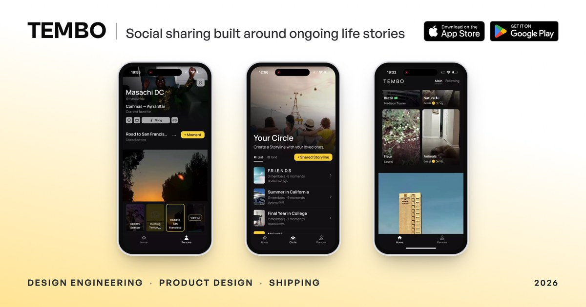

# Nathan Masachi

**Product designer who ships.**

I design products, build them, and put them in people's hands.

My background is in design, architecture, and computer science. I work across product strategy, interfaces, and engineering, from figuring out what to build to getting it into production.

Based in San Diego, California.

[Portfolio](https://masachidc.com) · [LinkedIn](https://www.linkedin.com/in/nathanmasachi/) · [Email](mailto:hello@masachidc.com)

## Selected work

### Tembo — A social app built around ongoing experiences

Most social apps are organized around people and posts. Tembo explores what happens when you organize them around ongoing experiences instead.

I founded, designed, and built Tembo. It's live on iOS and Android.

Beyond the interface, I've worked on everything from the database and media architecture to privacy, performance, testing, and releases.

<kbd> React Native</kbd> <kbd><a href="https://expo.dev"><picture><source media="(prefers-color-scheme: dark)" srcset="assets/stack/expo-dark.svg"></picture></a> Expo</kbd> <kbd> TypeScript</kbd> <kbd> Supabase</kbd> <kbd> Cloudflare</kbd>

[Case study](https://masachidc.com/works/tembo-app) · [Website](https://heytembo.com) · [App Store](https://apps.apple.com/us/app/tembo-storylines/id6804888179)

### KESHO — Call it before kickoff. Prove it after the whistle.

A social prediction app I designed and built for the 2026 World Cup.

I took it from concept to an invite-only beta with 29 active players. One of the biggest lessons came from onboarding: people signed up but didn't know what to do next. After adding guidance directly into the feed, median time to a first prediction dropped from nearly 36 hours to about five minutes.

I eventually shut KESHO down. The product taught me a great deal about building, testing with real people, and knowing when to move on.

<kbd><a href="https://nextjs.org"><picture><source media="(prefers-color-scheme: dark)" srcset="assets/stack/nextdotjs-dark.svg"></picture></a> Next.js</kbd> <kbd> TypeScript</kbd> <kbd> Supabase</kbd> <kbd> Capacitor</kbd>

[Case study](https://masachidc.com/works/kesho-app)
