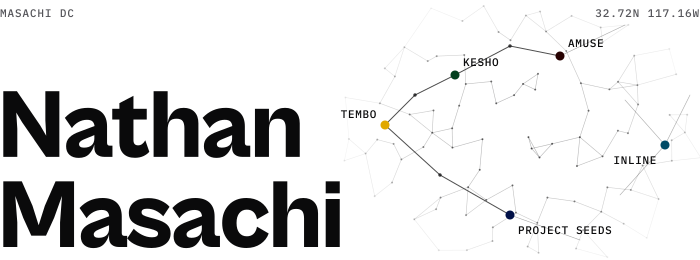
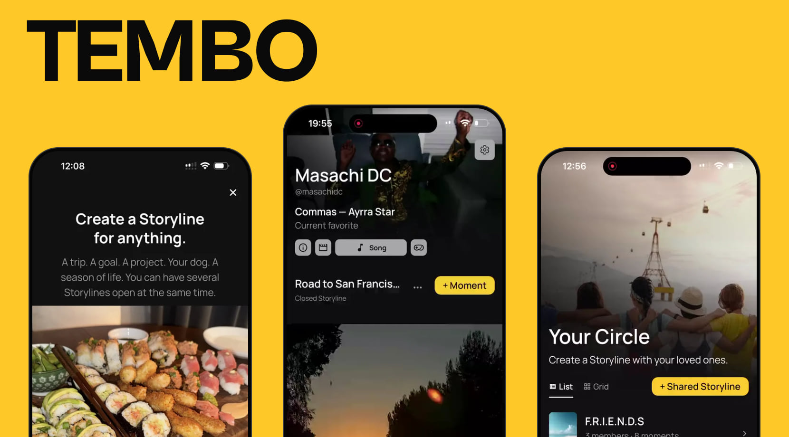
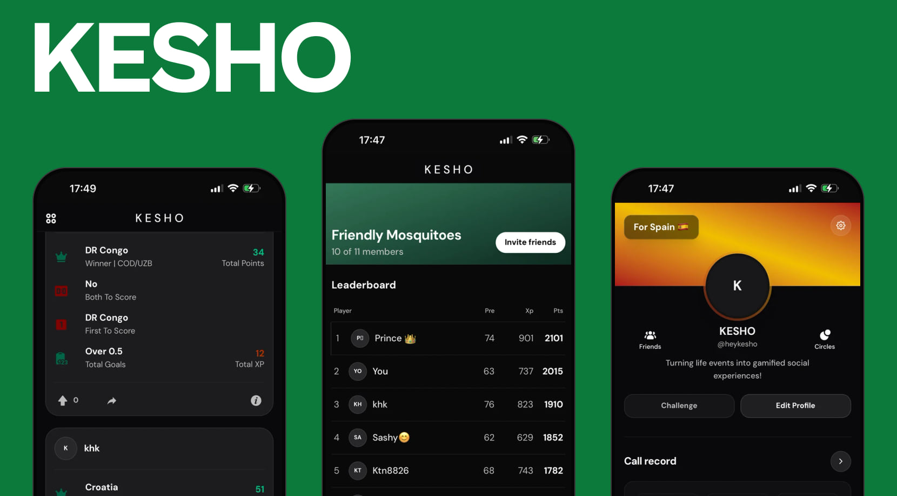

  <a href="https://masachidc.com">
    <picture>
      <source media="(prefers-color-scheme: dark)" srcset="assets/masthead-dark.svg">
      
    </picture>
  </a>

# Product designer who ships.

I design products, build them, and put them in people's hands.

My background is in design, architecture, and computer science. I work across product strategy, interfaces, and engineering, from figuring out what to build to getting it into production. Based in San Diego, California.

<samp>[Portfolio](https://masachidc.com) / [LinkedIn](https://www.linkedin.com/in/nathanmasachi/) / [Email](mailto:hello@masachidc.com)</samp>

<samp><b>Selected work</b></samp>

<a href="https://masachidc.com/works/tembo-app"><picture><source media="(max-width: 900px)" srcset="assets/tembo-narrow.jpg"></picture></a>

<samp>N°01 / Founder / iOS&nbsp;+&nbsp;Android / Aug&nbsp;2026–now</samp>

## TEMBO — A social app built around ongoing experiences

Most social apps are organized around people and posts. TEMBO explores what happens when you organize them around ongoing experiences instead.

I defined, designed, developed, and shipped TEMBO to the App and Play Stores.

Beyond the interface, I've worked on everything from the database and media architecture to privacy, performance, testing, and releases.

<kbd> React Native</kbd> <kbd> Expo</kbd> <kbd> TypeScript</kbd> <kbd> Supabase</kbd> <kbd> Cloudflare</kbd>

<samp>[Case&nbsp;study](https://masachidc.com/works/tembo-app) / [Website](https://heytembo.com) / [App&nbsp;Store](https://apps.apple.com/us/app/tembo-storylines/id6804888179) / [Google&nbsp;Play](https://play.google.com/store/apps/details?id=com.tembo.app)</samp>

 

<a href="https://masachidc.com/works/kesho-app"><picture><source media="(max-width: 900px)" srcset="assets/kesho-narrow.jpg"></picture></a>

<samp>N°02 / Designer&nbsp;+&nbsp;builder / Mar–Jun&nbsp;2026 / Decommissioned</samp>

## KESHO — Call it before kickoff. Prove it after the whistle.

A social prediction app I designed and built for the 2026 World Cup.

I took it from concept to an invite-only beta with 29 active players. One of the biggest lessons came from onboarding: people signed up but didn't know what to do next. After adding guidance directly into the feed, median time to a first prediction dropped from nearly 36 hours to about five minutes.

I eventually shut KESHO down. The product taught me a great deal about building, testing with real people, and knowing when to move on.

<kbd> Next.js</kbd> <kbd> TypeScript</kbd> <kbd> Supabase</kbd> <kbd> Capacitor</kbd>

<samp>[Case&nbsp;study](https://masachidc.com/works/kesho-app)</samp>

 

<samp><b>Other work</b></samp>

### [AMUSE](https://masachidc.com/works/amuse-art-museum)

<samp>N°03 / Product&nbsp;design&nbsp;+&nbsp;UX&nbsp;research / 2025</samp>

A museum discovery and booking experience for Kenya. Research led me away from a native app toward a simpler web experience.

### [Inline](https://masachidc.com/works/inline-chrome-extension)

<samp>N°04 / UX / 2026</samp>

A Chrome extension for annotating webpages. I worked on UX in a five-person team. Awarded Most Unique Project at FIU Blackstone LaunchPad Demo Day.

### [Project SEEDS](https://masachidc.com/works/project-seeds-branding)

<samp>N°05 / Brand&nbsp;identity&nbsp;+&nbsp;website / 2025</samp>

A university-approved brand identity and website designed for a program at Florida International University.

---

I like working with people who care about both what a product does and how it feels to use.

<samp>[See more of my work](https://masachidc.com) / [Get in touch](mailto:hello@masachidc.com)</samp>
