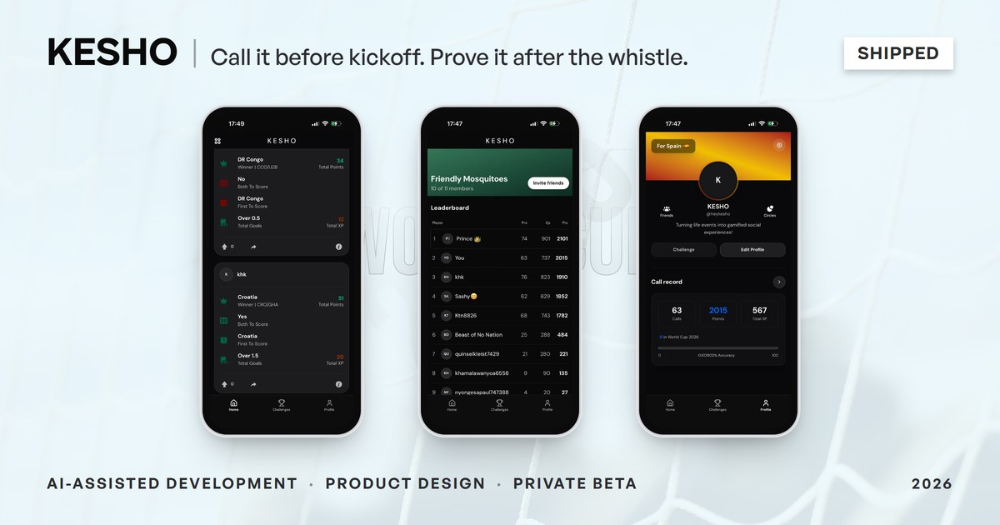

# Nathan Masachi

Product designer + engineer in Tampa, Florida. I trained in architecture, digital media and computer science, and I build what I design.

[masachidc.com](https://masachidc.com) · [hello@masachidc.com](mailto:hello@masachidc.com) · [LinkedIn](https://www.linkedin.com/in/nathanmasachi/) · [X](https://x.com/MasachiDC)

The code for Tembo and KESHO is in private repos, so this is what's in them. Ask and I'll walk you through it.

## Tembo

*Current*

A social app for people doing things over time. A trip, a goal or a hobby becomes a Storyline, and Moments are the updates added along the way. You follow the Storylines you care about instead of a whole account.

I founded it and own the product, design, engineering and release. It's live on the App Store and Google Play. Distribution is the problem I'm working on now.

- **Layered privacy.** The account sets the widest audience, each Storyline can narrow it, and Moments inherit the choice. The database and media delivery enforce it too.
- **One-tap posting.** Behind the tap, the app checks the Storyline can still take Moments, screens the photo before anyone sees it, and saves the Moment and its media together so nothing is half-published.
- **Testing.** 4,238 automated tests across the app, database and server functions as of October 2026. Load-tested on synthetic data up to 200 concurrent users, plus a 30-minute soak with 0 errors across 1.29M requests.
- **Workflow.** I build it with Claude Code. Nothing gets built until I approve it, and nothing ships until it passes automated tests, security checks and device testing.

`React Native` `Expo` `TypeScript` `Supabase` `Cloudflare` `GitHub Actions` `Sentry` `PostHog`

[Case study](https://masachidc.com/works/tembo-app) · [heytembo.com](https://heytembo.com) · [App Store](https://apps.apple.com/us/app/tembo-storylines/id6804888179) · [Google Play](https://play.google.com/store/apps/details?id=com.tembo.app)

## KESHO

*March to June 2026, decommissioned*

A football prediction app I designed and built for the 2026 World Cup, with no money involved. Fans sealed predictions before kickoff, then earned points and climbed leaderboards with friends after the whistle.

The web app went live and Android reached Google Play closed testing. In the invite-only beta, 29 of the 92 people I invited made at least one prediction, 584 in total.

- **Locks at kickoff.** Predictions were checked against kickoff on the server. A scheduled job locked each match and a recovery job caught any it missed. One prediction per player per match, with no edits.
- **Scoring.** Points came from implied probability, so a correct call on an unlikely outcome was worth more.
- **Onboarding.** I launched without it, and testers messaged me asking how to use the app. I shipped in-feed onboarding the next day. After that, median time from signup to first prediction fell from 35.9 hours to about 5 minutes.

Google Play cleared it to apply for production access and I chose not to. Users kept asking for gambling features, a product built on odds would keep drawing app review scrutiny, and wrapping Next.js in Capacitor caused repeated auth failures. I took the lessons into Tembo: less scope and a simpler stack.

`Next.js` `Supabase` `Capacitor` `QStash`

[Case study](https://masachidc.com/works/kesho-app)

## Also

- [**AMUSE**](https://masachidc.com/works/amuse-art-museum). Discover, plan and book museum visits in Kenya. Research moved it from a native app to a lightweight web platform with M-Pesa booking.
- [**Inline**](https://masachidc.com/works/inline-chrome-extension). A Chrome extension for annotating any webpage. I was the UX designer on a five-person team. Most Unique Project at FIU Blackstone LaunchPad Demo Day.
- [**Project SEEDS**](https://masachidc.com/works/project-seeds-branding). A program identity within FIU's brand system, and a website non-technical staff can maintain.
